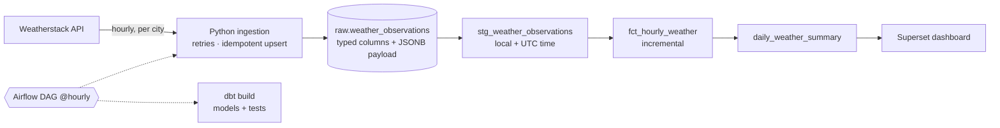
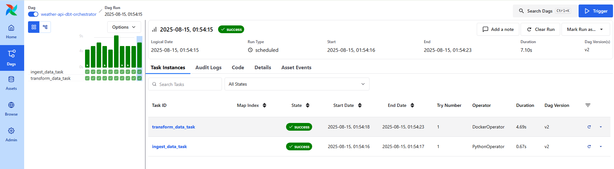
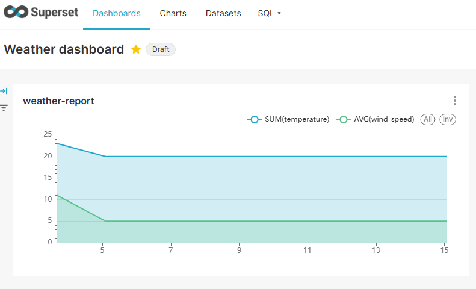

# Weather Data Pipeline

[](https://github.com/tecozu/weather-data-pipeline/actions/workflows/ci.yml)


An hourly ELT pipeline. It ingests current weather for several Brazilian cities from
the [Weatherstack](https://weatherstack.com/) API into PostgreSQL, models it with dbt
and serves it in Superset. Everything is orchestrated by Airflow and runs in Docker Compose.





## Origin and what I added

The first version followed a [code-along tutorial by Calvin Yoon](https://www.youtube.com/watch?v=vMgFadPxOLk),
which is credited here. I then reworked it to production standards:

| Area | Tutorial version | This version |
|---|---|---|
| Scheduling | every 5 minutes | `@hourly`, retries, `max_active_runs=1`. The free API tier allows ~100 calls/month, so 5-minute polling burned it in hours |
| Idempotency | plain `INSERT` | primary key `(city, observed_at)` + `ON CONFLICT DO NOTHING`, so re-runs never duplicate |
| Replayability | only a few parsed columns stored | the full **JSONB payload** is kept, so new fields come from SQL without calling the API again (e.g. `uv_index`) |
| API errors | quota errors (HTTP 200 with an `error` body) crashed later steps | detected and raised as `PayloadError` before anything is written |
| Scope | one city | any list of cities (`WEATHER_CITIES`) |
| Deduplication | by timestamp only, which merged different cities | by city and hour |
| dbt | `run` only, no tests | `build` with tests (ranges, grain uniqueness, min ≤ avg ≤ max), an **incremental** hourly fact with late-data lookback, source freshness |
| Secrets | passwords in code, compose file and `profiles.yml` | everything in `.env` (template in `.env.example`) |
| Portability | hard-coded `/root/repos/...` mounts | paths from `HOST_PROJECT_DIR` |
| Testing / CI | none | pytest + ruff, and GitHub Actions running the **real pipeline against a Postgres service**: ingest 72 h of mock data twice (the second run must insert 0 rows), `dbt build` twice (full, then incremental), validate the compose file |

## Run it

```bash
cp .env.example .env          # set WEATHER_API_KEY (or WEATHER_API_MOCK=1) and passwords
docker compose up -d
```

| Service | URL |
|---|---|
| Airflow | http://localhost:8080 (password printed by `airflow standalone` in the logs) |
| Superset | http://localhost:8088 (`admin` / `ADMIN_PASSWORD`) |
| Postgres | `localhost:5432` |

Without Docker or an API key, using any Postgres:

```bash
pip install -r requirements-dev.txt
export POSTGRES_HOST=localhost POSTGRES_PASSWORD=... WEATHER_CITIES="Rio de Janeiro;Recife"
python ingestion/weather_ingestion.py backfill-mock 72      # 72 hours of deterministic data
cd dbt && dbt build --profiles-dir .
```

## Data model

| Model | Grain | Notes |
|---|---|---|
| `raw.weather_observations` | city × observation | landed by Python; JSONB payload kept |
| `stg_weather_observations` | city × observation | typed; local **and** UTC timestamps |
| `fct_hourly_weather` | city × hour | incremental (`delete+insert`, 1-day lookback) |
| `daily_weather_summary` | city × day | min/max/avg, rain hours, **coverage ratio** (hours observed / 24) to spot ingestion gaps |



## Contact

[LinkedIn](https://www.linkedin.com/in/araujo-o-renato/) · araujorenato.o@outlook.com
