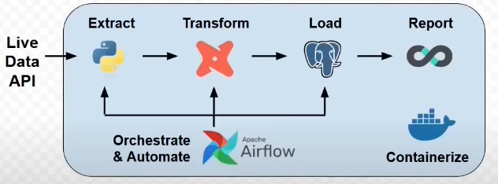
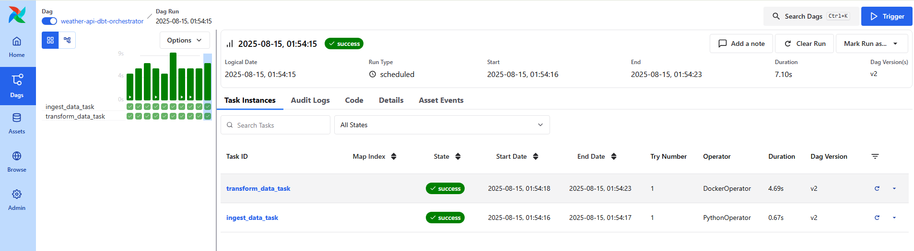
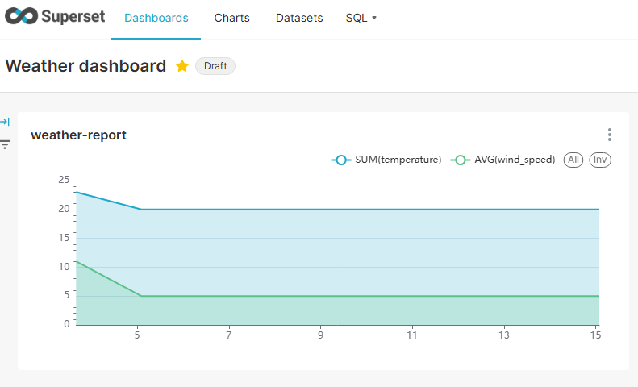

# Data Pipeline Project – Weather Report
This project extracts live data from an API using python scripts, performs transformations using dbt, and loads the results into PostgreSQL. The data is then visualized in Superset, with the entire process orchestrated by Airflow running in Docker containers.

## 📬 Contact

- [LinkedIn](https://www.linkedin.com/in/araujo-o-renato/) – Feel free to connect!
- Email: araujorenato.o@outlook.com

This project is based on a code-along video by [Calvin Yoon][tutorial]. All credit goes to his video, which made this learning project possible.
# Steps:
1. **Donwload Visual Studio Code and set up linux instance**
    * Install the WSL extension
    * Add the Ubuntu 24.04 LTS distribution
    * Set up a username and password (if prompted)
    * Create the project folder `weather-data-project`
        
    **Bash commands used:**
    > `mkdir repos` : Creates a folder to host the project(The folder can alsobe accessed via File Explorer: \\wsl$\Ubuntu-24.04\home\user or \\wsllocalhost\Ubuntu-24.04\root if a user was not created)  
    > `sudo apt update` and `sudo apt full-upgrade`: Updates the packagelist and upgrades all packages on the instance  
    `Clear`: Clear terminal  
    >`python3 -- version`: To check python version installed  
    `pip --version`: Check pip version (If not installed then run `sudo aptinstall  python3-pip` )
    > `ls -l (path)`: Used to check permision on folder  
    > `sudo chmod -R g+rw (path)`Add group write permission on dir  
    > `sudo chgrp -R $USER (path)` Change group to user group  
    > `sudo chmod -R 770 (path)` Enable group write permision
    > `sudo rm - rf (path)` Delete folder 
2. **Download Docker**

    * Activate **WSL integration**:  
      * Go to **Settings > Resources > WSL Integration**  
      * Enable integration for the created WSL distribution  

    **Commands:**  
    > `docker-compose up` – Runs the YAML file and sets up the services  
    > `docker-compose exec db psql -U db_user -d db` – Accesses the PostgreSQL database service through the terminal  
    > `docker-compose ps` - To see the containers that are running  
    > `docker-compose down` - To stop running containers  
    > `docker ps -a` - To see a list of all containers  
    > `docker cp (id&path) (path)` - To copy file from one location to another  
3. **Create an Account on [Weatherstack](https://weatherstack.com/)**  
    * Obtain **API Access Key**  

4. **Set Up Project Folder**  
    * Create a folder `weather-data-project` inside `repos`  
    * Inside this folder, create a subfolder `api-request`  
    * Create a virtual environment `python3 -m venv .venv`
    * Create `api_request.py` to fetch the JSON response from the API  
    * Create `insert_records.py` to insert the API response into the PostgreSQL database  

5. **Create `docker-compose.yaml`**  
    * Define the services used in the project:  
      * **PostgreSQL**  
      * **Airflow**  
      * **dbt**  
      * **Superset**  

6. **Using postgrees**

    **Commands:**  
    > `\l` – List databases   
    > `\dn` – List of schemas  
    > `\c db` Connect to db database  
    > `\dt public.*` – Connect to `db` database  
    
7. **AIRFLOW - Automating `insert_record.py` to avoid manual execution**
   * Define af on `docker_compose.yaml`
   * Creating `airflow_init.sql` on postgres folder
   * Create `airflow/dags` folder
   * Create `orchestrator.py` file

8. **DBT For transform data**
   * Define dbt on `docker_compose.yaml` on command, used `dbt init my_project`
   * To set up dbt `docker-compose run dbt`
   * For configuration, host, port and etc should be what was defined on `docker-compose.yml` and `insert_records.py` file
   * Replace command on `docker-compose.yml` to `debug` and `docker-compose down` and `docker-compose up` to start container again
   * Locate `profiles.yml` on dbt container and copy to dbt project folder 
   * Replace command on `docker-compose.yml` to `run `
   * Create `sources.yml` file on dbt sources folder to map raw_weather_data table.
   * Create staging layer `stg_weather_data.sql` to first tranformations 
   * Create mart layer with `daily_average.sql` and `weather_report.sql`. Here is the layer that we intend to use on reports

9. **SuperSet to visualize the data** 
   *  Copy some parts of `docker-compose.yml` from [superset github](https://github.com/apache/superset) 
      * Superset
      * Superset-init
      * Redis
   * Create docker folder and copy some files from superset github 
      * docker-init.sh
      * docker-bootstrap.sh 
      * superset_config   
      * .env 
   * Small changes on files to project use (For detailed instructions follow the [tutorial]) 

# Results:   
### **Airflow**

### Superset 

### Conclusion

This is my first public project on this platform, and I’m excited to share it!

The project covers key concepts in modern data engineering using industry-standard tools: Python, dbt, and Airflow. It demonstrates a full ETL/ELT pipeline: extracting live data from an API, transforming it in dbt, loading it into PostgreSQL, and visualizing it in Superset.

Additionally, it leverages Docker containers for isolation and reproducibility, ensuring that the project can be easily replicated in different environments. By integrating Airflow, the pipeline is fully orchestrated and automated, providing real-world experience in managing workflows.

This project also showcases best practices for handling sensitive credentials (using environment variables or Airflow Variables) and highlights the use of open-source visualization tools.

Through this project, I gained practical experience with containerization, workflow orchestration, and modern data transformation tools, building a solid foundation for professional data engineering projects.

It is now ready to serve as a portfolio project to demonstrate hands-on skills for potential data engineering roles, particularly for international opportunities.

Important: some credentials are exposed in this project. In production environments, it is essential to use `.env` files or other secure methods to manage sensitive information.

[tutorial]: https://www.youtube.com/watch?v=vMgFadPxOLk&list=LL